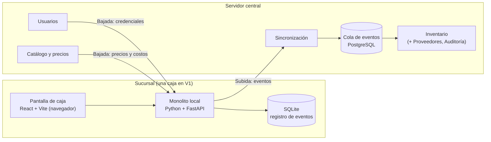

# Arquitectura — Pumaverso POS

Este documento resume cómo se organiza el sistema y enlaza las decisiones de arquitectura. El detalle completo de requisitos y reglas está en [`CONTEXTO_PROYECTO.md`](CONTEXTO_PROYECTO.md).

## Vista general

Cada sucursal ejecuta un **monolito local** que registra todo primero en su propia base de datos SQLite y funciona sin conexión. Cuando hay red, un proceso en segundo plano sincroniza con los **servicios centrales**.

## Componentes

| Componente | Ubicación en el repositorio | Tecnología |
|---|---|---|
| Monolito de la sucursal | `apps/tienda/` | Python 3.13, FastAPI, SQLite |
| Pantalla de caja | `apps/caja/` | TypeScript, React, Vite; Tauri opcional |
| Servicios centrales | `apps/central/` | Python, FastAPI, PostgreSQL |
| Contrato de eventos | `packages/contratos/` | Python, Pydantic |

## Reglas que no se negocian

- La venta se registra primero en la sucursal; nunca depende de que central responda.
- El registro de eventos es *append-only*: las correcciones son eventos nuevos.
- Cada evento se identifica por sucursal + caja + consecutivo, y central lo recibe de forma idempotente.
- Dentro de la sucursal no se usan microservicios, para mantener las transacciones atómicas.

## Decisiones de arquitectura

Cada decisión vive en su propio archivo dentro de [`decisiones/`](decisiones/). Una decisión nueva se agrega con el siguiente número disponible.

| Número | Decisión | Estado |
|---|---|---|
| [0001](decisiones/0001-cola-de-eventos-postgresql.md) | La cola de eventos se implementa en PostgreSQL | Aceptada |
| [0002](decisiones/0002-codigo-central-en-apps-central.md) | El código de central vive en `apps/central/` | Aceptada |
| [0003](decisiones/0003-contrato-de-eventos-en-packages-contratos.md) | El contrato de eventos vive en `packages/contratos/` | Aceptada |
| [0004](decisiones/0004-una-caja-por-sucursal.md) | Una caja por sucursal en V1 | Aceptada |
| [0005](decisiones/0005-registro-de-eventos-inmutable.md) | Registro de eventos inmutable y estado de sincronización aparte | Aceptada |
| [0006](decisiones/0006-vigencia-sesiones-y-validacion-en-central.md) | Vigencia desde la recepción, sesiones con PIN y validación en central | Aceptada |
| [0007](decisiones/0007-sincronizacion-automatica.md) | Sincronización y cola automáticas dentro de cada aplicación | Aceptada |
| [0008](decisiones/0008-pantalla-de-caja-web.md) | Pantalla de caja como aplicación web; Tauri opcional | Aceptada |
| [0009](decisiones/0009-deteccion-de-inventario-fantasma.md) | Detección de inventario fantasma y cola aplicada de uno en uno | Aceptada |
| [0010](decisiones/0010-credenciales-en-la-api-de-central.md) | Credenciales en la API de central | Aceptada |
